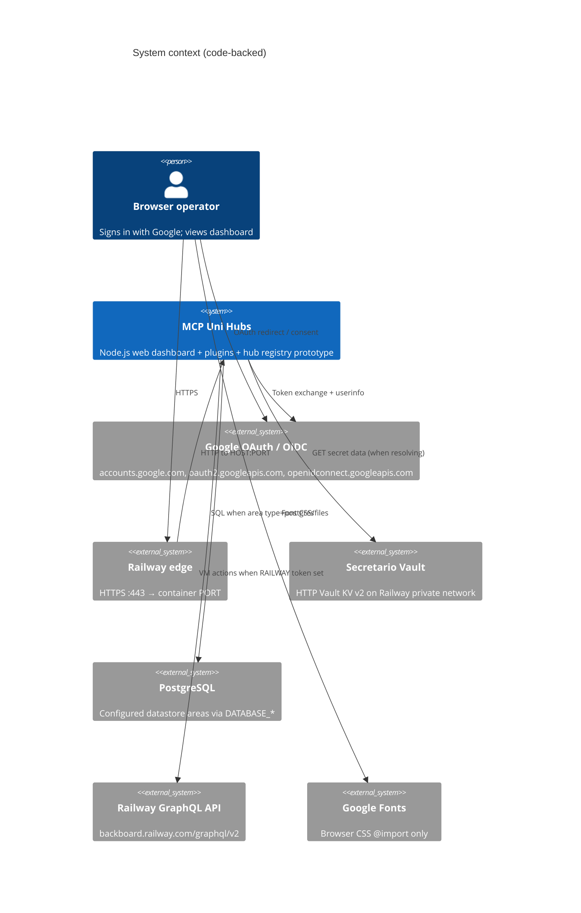
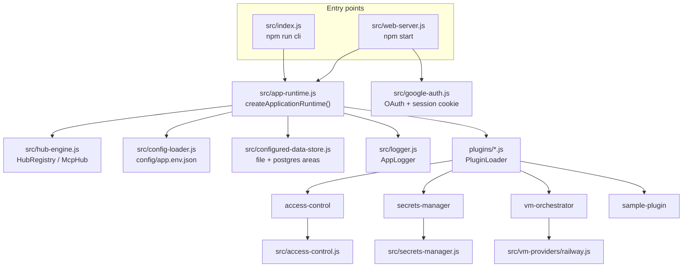
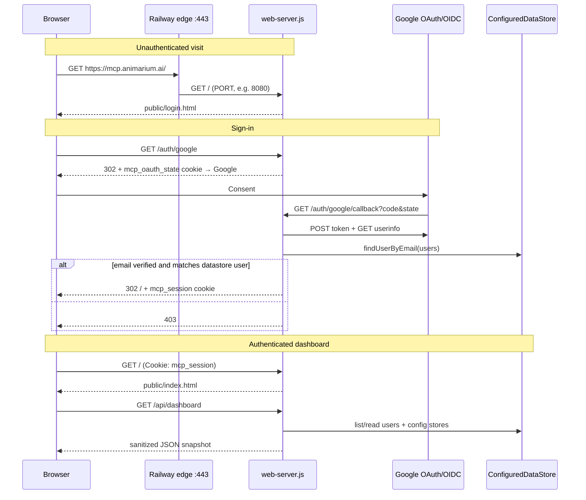

# Solution Architecture

Top-level view of MCP Uni Hubs based on the current repository. Statements below are grounded in code and config under `src/`, `plugins/`, `config/`, `public/`, `railway.toml`, and related docs. Items that cannot be confirmed from the repo are labeled **Assumption**.

For task-scoped detail, use the [architecture index](architecture.md) and [documentation map](README.md). For network edges and ports, see [CONNECTIVITY.md](CONNECTIVITY.md).

## 1. Purpose and scope

MCP Uni Hubs is a **dependency-light Node.js ES-module prototype** (`package.json`: `"MCP hubs engine prototype"`). It combines:

- An in-memory **MCP hub registry** with static sample hub records (`src/hub-engine.js`).
- Auto-discovered **plugins** (access control, secrets resolution, VM orchestration, sample plugin).
- A **configured datastore** that routes record areas to local JSON files and/or PostgreSQL (`src/configured-data-store.js`, `config/app.env.json`).
- A **Google-OAuth-protected HTTP operations dashboard** (`src/web-server.js`, `public/`).

**Out of scope of the current code:** this application does **not** implement an MCP protocol server, does **not** advertise MCP tools/resources/prompts over stdio/SSE/HTTP MCP transports, and does **not** act as a live hub discovery client. The hub registry is a local prototype object graph only.

## 2. System context

**Assumption:** Production is deployed as the Railway service that serves [https://mcp.animarium.ai](https://mcp.animarium.ai). The custom domain and Railway project wiring are documented in `README.md` / `docs/platforms/railway.md`; they are not encoded as constants in application source (except OAuth `PUBLIC_BASE_URL` at runtime).

## 3. Component and module overview

| Module | Role (as implemented) |
| --- | --- |
| `src/hub-engine.js` | In-memory `HubRegistry` with three static sample hubs (`docs-hub`, `runtime-hub`, `watcher-hub`). |
| `src/app-runtime.js` | Composition root: config load, datastore init/bootstrap, plugin load, CLI/dashboard summary helpers. |
| `src/web-server.js` | Node `http` dashboard server; Google session gates dashboard assets and `/api/*`. |
| `src/google-auth.js` | OAuth start/callback, signed `mcp_session` cookie, user match by datastore email. |
| `src/configured-data-store.js` | Per-area routing to `LocalDataStore` or PostgreSQL JSONB tables. |
| `src/local-data-store.js` | JSON file persistence + `PluginLoader`. |
| `src/secrets-manager.js` | Secret ref resolution; only **Secretario** performs real HTTP fetches. |
| `src/access-control.js` | `canAccess()` decision service; **not** auto-enforced by web routes or plugin methods. |
| `plugins/vm-orchestrator.js` | VM CRUD/lifecycle; Railway provider may call GraphQL; other cloud providers return local simulations. |
| `src/data-connection-manager.js` | Legacy file/SQL abstraction; SQL mode is in-memory prototype, not the runtime PostgreSQL path. |
| `public/` | Login page, dashboard HTML/JS/CSS. |

## 4. Exposed MCP tools, resources, and prompts

**None.**

There is no MCP server handshake, tool registry, resource URI catalog, or prompt list in this codebase. Grep of `src/` shows no MCP protocol handlers (`listTools`, resources/prompts APIs, `@modelcontextprotocol`, etc.).

What exists instead:

- **Hub registry prototype:** `createDefaultRegistry()` registers three `McpHub` objects with transport labels `http`, `stdio`, and `sse`. Those transport strings are metadata on sample records; they are not listening MCP endpoints.
- **HTTP surface:** browser/dashboard routes only (see §5).
- **Plugins:** in-process factories loaded from `plugins/`; they are not exposed as MCP tools by the web server.

## 5. Runtime and request flow

Shared bootstrap (CLI and web) is `createApplicationRuntime()`:

1. Build default hub registry and summary.
2. Create logger (`createDefaultLogger`).
3. Load `config/app.env.json` (fallback `config/app.config.json` on missing primary file); expand `${ENV}` placeholders.
4. Initialize `ConfiguredDataStore` (PostgreSQL pool when any area is `postgres`).
5. Bootstrap identity/store/ACL/VM seed data from config.
6. `PluginLoader` imports each top-level `plugins/*.js`.

### Typical HTTP dashboard request

**MCP-related call:** there is no inbound MCP request path. Hub status appears only inside runtime summary / dashboard payload (`hubStatus` from the in-memory registry). Invoking `npm run cli` prints that summary as JSON and exits; it does not open an MCP transport.

### Web routes (actual)

| Request | Behavior |
| --- | --- |
| `GET /` | Login HTML without session; dashboard HTML with valid session |
| `GET /auth/google` | Start OAuth (503 if not configured) |
| `GET /auth/google/callback` | Exchange code, match user, set session |
| `GET`/`POST /auth/logout` | Clear session, redirect `/` |
| `GET /api/me` | Session identity JSON or 401 |
| `GET /api/dashboard` | Session required; `buildDashboardData(runtime)` |
| `GET /app.js`, `GET /styles.css` | Authenticated dashboard assets |
| Other | 404; unsupported methods 405 |

## 6. Configuration and environment variables

Primary config file: `config/app.env.json` (stores, `datastores` routing, bootstrap users/groups/orgs/ACLs/environments). Credentials use `${VAR}` placeholders; bootstrap strips credential-shaped fields before writing store records to the datastore.

| Variable | Used by | Purpose |
| --- | --- | --- |
| `PORT` | `web-server.js` | Listen port (default `3000` if unset; Railway commonly `8080`) |
| `HOST` | `web-server.js` | Bind address (default `0.0.0.0`) |
| `PUBLIC_BASE_URL` | `google-auth.js` | Canonical origin; builds `/auth/google/callback` |
| `GOOGLE_CLIENT_ID` | `google-auth.js` | OAuth client ID |
| `GOOGLE_CLIENT_SECRET` | `google-auth.js` | OAuth client secret (exact name) |
| `SESSION_SECRET` | `google-auth.js` | HMAC key for `mcp_session` |
| `SECRETARIO_TOKEN` | config → secrets-manager | Vault token / `X-Vault-Token` |
| `DATABASE_HOST` / `PORT` / `DBNAME` / `USER` / `PASSWORD` | `configured-data-store.js` | Required when any area is `postgres` |
| `RAILWAY_TOKEN` or `RAILWAY_API_TOKEN` | `vm-providers/railway.js` | GraphQL Bearer token |
| `RAILWAY_API_ENDPOINT` | railway provider | Default `https://backboard.railway.com/graphql/v2` |
| `RAILWAY_PROJECT_ID` / `ENVIRONMENT_ID` / `SERVICE_ID` | railway provider | Target project/env/service |
| `RAILWAY_MCP_001_IMAGE` / `RAILWAY_MCP_001_REPO` | railway provider | Create source for sample VM |
| `LOG_LEVEL` / `LOG_DIR` / `INSTANCE_ID` / `SERVICE_NAME` | `logger.js` | File logging |

Never commit secret **values**. Document names only (this file follows that rule).

Checked-in `datastores` routing (`config/app.env.json`): users, groups, organizations, user-environments, and acls → `postgres`; stores and virtual-machines → `file`.

## 7. Build and deployment

- **Runtime:** Node.js ES modules; sole npm dependency is `pg` (PostgreSQL driver).
- **Scripts:** `npm start` / `npm run web` → `node src/web-server.js`; `npm run cli` → summary JSON; `npm test` → `node --test`.
- **Railway:** [`railway.toml`](../railway.toml) sets `deploy.startCommand = "npm start"`. Public HTTPS terminates at the Railway edge on **:443**; the container listens on **`PORT`** (commonly **8080**). Clients use [https://mcp.animarium.ai](https://mcp.animarium.ai) — not `:8080` on the custom domain.
- **No separate build step** in `package.json` (no bundler compile for the server).

## 8. Security

| Topic | Behavior in code |
| --- | --- |
| Google OAuth | Authorization code flow; scopes `openid email profile`; state cookie `mcp_oauth_state` (10 min). |
| Session | Signed cookie `mcp_session` (HMAC-SHA256, 12 h TTL); `HttpOnly`, `Secure`, `SameSite=Lax` by default. |
| Access gate | **Not** a separate email allowlist file. Sign-in requires Google `email_verified === true` **and** a case-insensitive match to an existing `users` datastore record. Unmatched emails get 403; users are **not** auto-created. |
| Dashboard ACL | `AccessControlPlugin.canAccess()` exists but **web routes and plugin methods do not call it**. Session authentication ≠ plugin authorization enforcement. |
| Secrets | `SECRETARIO_TOKEN`, Google/session secrets, Railway tokens, and `DATABASE_*` are runtime env vars. Dashboard store metadata omits tokens; resolved secret maps must not be logged or returned by dashboard APIs. |
| HTTP headers | `X-Content-Type-Options: nosniff`, `Referrer-Policy: no-referrer`, `Cache-Control: no-store`, CSP on static pages. |
| Login CSP | Allows Google Fonts; `script-src 'none'` on login page. |

## 9. Observability

`AppLogger` (`src/logger.js`) writes JSON lines to `LOG_DIR` files named `{SERVICE_NAME}-{date}-{INSTANCE_ID}.log`. Levels: `DEBUG`, `INFO`, `WARN`, `ERROR`, `CRITICAL` (threshold from `LOG_LEVEL`, default `INFO`).

There is no metrics exporter, distributed tracing, or structured request-access log middleware in `web-server.js`. Dashboard `status: "Configured"` for stores is metadata, not a live health probe. **Assumption:** operators rely on Railway deployment logs plus optional container log files (filesystem may be ephemeral).

## 10. Limitations and future improvements

Grounded in current behavior / explicit prototype boundaries:

1. **No MCP protocol surface** — hub registry is in-memory sample data only.
2. **ACL decision ≠ enforcement** — callers must wire `canAccess()` before protected operations.
3. **Non-Railway VM providers** and **non-Secretario secret backends** are local placeholders / simulations.
4. **`UniversalConnectionManager` SQL mode** is in-memory and unused as the PostgreSQL runtime path.
5. **Local `data/` areas** may be ephemeral on Railway without a volume.
6. **Switching datastore backends does not migrate** existing records.
7. **No automated remote health checks** for Secretario or Railway from the dashboard API.

Plausible future work (not implemented): MCP server exposing tools/resources/prompts; enforce ACLs at HTTP/plugin boundaries; real cloud provider adapters; durable volumes or full SQL for all areas; request logging and health probes.

## Related references

- [CONNECTIVITY.md](CONNECTIVITY.md) — trust boundaries, ports, connection inventory
- [architecture/runtime-flow.md](architecture/runtime-flow.md) — bootstrap and dashboard flow detail
- [architecture/components.md](architecture/components.md) — module contracts
- [architecture/authorization.md](architecture/authorization.md) — ACL evaluation
- [architecture/data-models.md](architecture/data-models.md) — record shapes
- [platforms/railway.md](platforms/railway.md) — Railway operations
