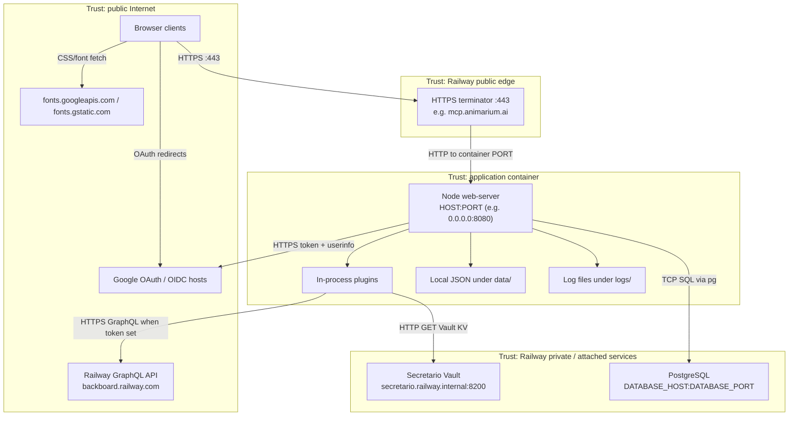
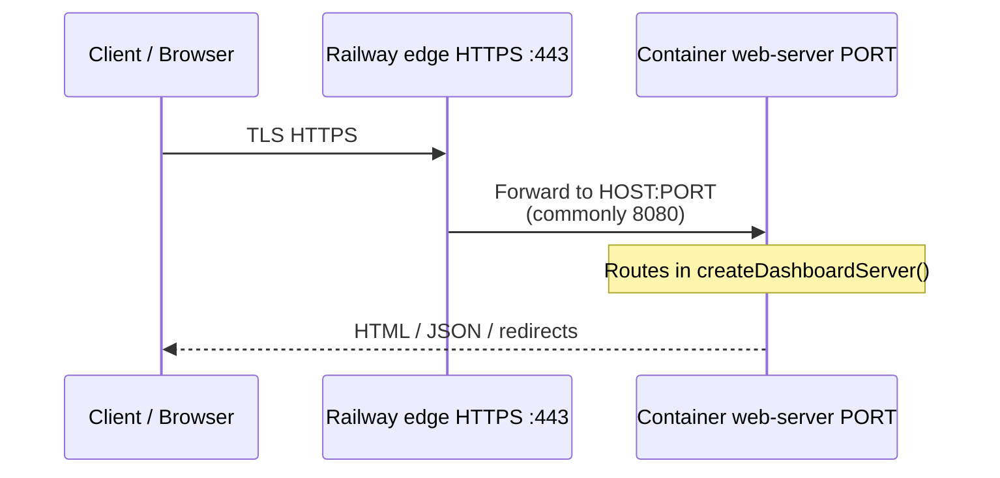
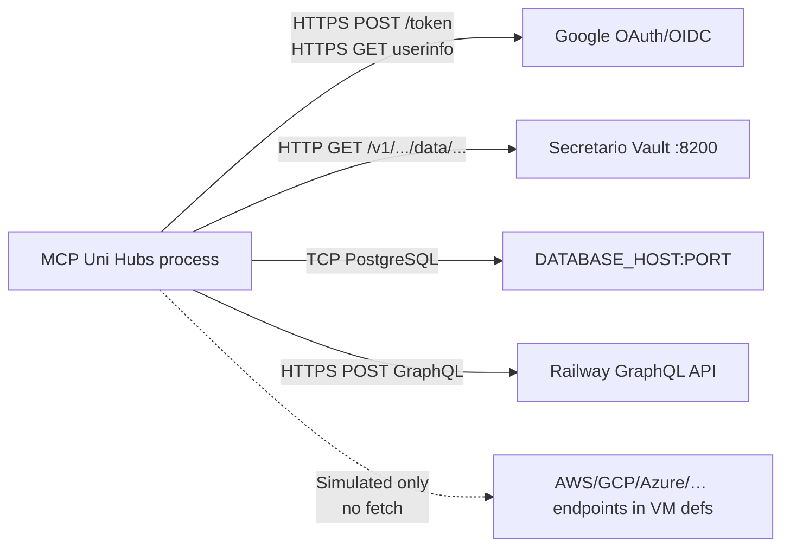

# Connectivity

Network and trust-boundary view of MCP Uni Hubs, derived from `src/web-server.js`, `src/google-auth.js`, `src/secrets-manager.js`, `src/vm-providers/railway.js`, `src/configured-data-store.js`, `config/app.env.json`, `railway.toml`, and `public/` assets. Unconfirmed production topology details are marked **Assumption**.

Companion: [ARCHITECTURE.md](ARCHITECTURE.md). Operational variable list: [platforms/railway.md](platforms/railway.md).

## 1. Trust boundaries

**Boundary notes (code-backed):**

- Session trust is the signed `mcp_session` cookie verified with `SESSION_SECRET` inside the container.
- OAuth trust depends on Google token endpoints plus matching a local datastore user email (not a separate allowlist file).
- Secretario address in config is `http://secretario.railway.internal:8200` (plain HTTP on the internal hostname).
- Railway VM API calls use Bearer `RAILWAY_TOKEN` / `RAILWAY_API_TOKEN` to the public GraphQL endpoint.
- Non-Railway cloud “endpoints” in VM definitions are **simulated** in-process; no outbound API call is made for AWS/GCP/Azure/etc. handlers in `plugins/vm-orchestrator.js`.

**Assumption:** Railway private DNS (`*.railway.internal`) and PostgreSQL reachability match the deployed service network; the app does not configure VPC/firewall rules itself.

## 2. Inbound connectivity

| Path | Auth at edge / app | Destination handler |
| --- | --- | --- |
| `https://…/` (no session) | Public | `public/login.html` |
| `https://…/auth/google` | Public; requires OAuth env config | Redirect to Google |
| `https://…/auth/google/callback` | OAuth state cookie + code | Session issue or 403 |
| `https://…/auth/logout` | Clears cookie | Redirect `/` |
| `https://…/`, `/app.js`, `/styles.css` (session) | `mcp_session` | Dashboard assets |
| `https://…/api/me`, `/api/dashboard` | `mcp_session` | JSON APIs |

- **Transport inbound:** HTTPS to the public hostname; HTTP inside the container after edge termination.
- **Listen:** `process.env.PORT` (default `3000` locally) on `process.env.HOST` (default `0.0.0.0`).
- **No inbound MCP port** (stdio/SSE/MCP HTTP) is opened by this process.

## 3. Outbound connectivity

| Target | When | Protocol | Auth |
| --- | --- | --- | --- |
| `accounts.google.com` | Browser redirect from `/auth/google` | HTTPS | OAuth client ID in query |
| `oauth2.googleapis.com/token` | Callback | HTTPS POST | `GOOGLE_CLIENT_ID` + `GOOGLE_CLIENT_SECRET` |
| `openidconnect.googleapis.com/v1/userinfo` | Callback | HTTPS GET | Bearer access token |
| `secretario.railway.internal:8200` | `SecretsManagerPlugin.resolveUserEnvironment` | HTTP GET | `X-Vault-Token` ← `SECRETARIO_TOKEN` |
| PostgreSQL `DATABASE_*` | Startup + datastore ops for `postgres` areas | TCP (pg) | DB user/password |
| `RAILWAY_API_ENDPOINT` (default `https://backboard.railway.com/graphql/v2`) | Railway VM create/start/stop/delete | HTTPS POST | Bearer `RAILWAY_TOKEN` or `RAILWAY_API_TOKEN` |
| Google Fonts | Browser loading login/dashboard CSS | HTTPS | None (public CSS) |

Placeholder secret backends (CyberVault, Infisical, OpenBAO, etc.) return synthetic values in-process and do **not** open network connections.

## 4. Transports, ports, and auth points

| Concern | Value |
| --- | --- |
| Public client transport | HTTPS `:443` (Railway edge) |
| Container listen | `PORT` (Railway commonly `8080`); `HOST=0.0.0.0` |
| Session auth | Cookie `mcp_session` (HMAC with `SESSION_SECRET`) |
| OAuth state | Cookie `mcp_oauth_state` |
| Vault | Config port **8200**, protocol **http**, host `secretario.railway.internal` |
| PostgreSQL | `DATABASE_PORT` from env (required integer 1–65535 when postgres areas exist) |
| Railway API | HTTPS default port **443** to GraphQL URL |
| MCP transports on sample hubs | Labels only (`http` / `stdio` / `sse`); not bound sockets |

## 5. Connection inventory

| Source | Destination | Protocol | Port | Auth | Direction |
| --- | --- | --- | --- | --- | --- |
| Browser | Railway edge (`mcp.animarium.ai`) | HTTPS | 443 | TLS; then app session cookie for protected paths | Inbound to system |
| Railway edge | Container `web-server` | HTTP | `PORT` (e.g. 8080) | Private platform network (**Assumption:** Railway mesh) | Inbound |
| Browser | `accounts.google.com` | HTTPS | 443 | OAuth client ID | Outbound (browser) |
| `google-auth.js` | `oauth2.googleapis.com` | HTTPS | 443 | Client ID + secret | Outbound |
| `google-auth.js` | `openidconnect.googleapis.com` | HTTPS | 443 | Bearer access token | Outbound |
| Browser | `fonts.googleapis.com` / `fonts.gstatic.com` | HTTPS | 443 | None | Outbound (browser) |
| `secrets-manager` (Secretario) | `secretario.railway.internal` | HTTP | 8200 | `X-Vault-Token` (`SECRETARIO_TOKEN`) | Outbound |
| `configured-data-store` | `DATABASE_HOST` | PostgreSQL/TCP | `DATABASE_PORT` | `DATABASE_USER` / `DATABASE_PASSWORD` | Outbound |
| `vm-providers/railway.js` | `RAILWAY_API_ENDPOINT` | HTTPS | 443 | Bearer Railway token | Outbound |
| VM providers AWS/GCP/Azure/VMware/IBM/OpenStack | Documented cloud endpoints in definitions | — | — | — | **None** (local simulation) |
| MCP clients | Hub registry transports | — | — | — | **None** (no MCP server listener) |

## 6. Related

- [ARCHITECTURE.md](ARCHITECTURE.md) — system context and request sequences
- [platforms/railway.md](platforms/railway.md) — deploy variables and caveats
- [architecture/runtime-flow.md](architecture/runtime-flow.md) — dashboard and secrets resolution flows
